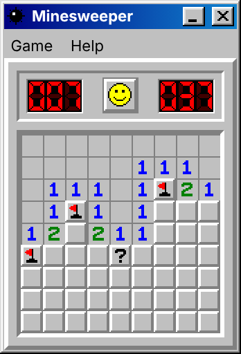

# Minesweeper

A faithful browser recreation of Windows 95/98 Minesweeper, built with React and TypeScript.

**Play it: https://1cto.github.io/minesweeper/**



## Features

- The classic rules: three Difficulties (Beginner, Intermediate, Expert), a first Reveal that is never a Mine, Cascades, Flags and Questions on the right button, and the Chord on the middle button or both buttons.
- The original feel: Cells press in under the mouse and open on release, the smiley reacts, the timer counts to 999 and the mine counter can go negative.
- The original look: a Windows 98 window with Game and Help menus, Win and Loss presentations, and Best Times with player names kept in the browser.
- Drawn at the largest whole-number scale (×1, ×2 or ×3) that fits the screen, so every pixel stays crisp.

## Run it locally

You need Node.js 22 and pnpm 10.

```sh
pnpm install        # dependencies
pnpm dev            # dev server at http://localhost:5173/minesweeper/
pnpm test           # engine tests (Vitest)
pnpm test:e2e       # browser tests (Playwright; builds and serves a test build)
pnpm build          # production build in dist/
```

`pnpm typecheck`, `pnpm lint` and `pnpm format:check` run the remaining checks that CI runs on every pull request.

## Stack

React 19, TypeScript in strict mode, Vite, pnpm, Vitest, Playwright, ESLint and Prettier. GitHub Actions checks every pull request and publishes `main` to GitHub Pages.

## How it is built

The vocabulary used in the code, tests and issues (Board, Cell, Reveal, Flag, Chord, Cascade, Layout, Best Time, …) is defined in the domain glossary, [`CONTEXT.md`](CONTEXT.md).

- **Engine** (`src/engine/`): the rules as pure functions over immutable state, with no framework and no access to the clock or global randomness. `newGame(difficulty, { random, layout? })` creates a Game and `applyAction(game, action)` returns the next one; every action carries the current time. Queries such as `cellView`, `mineCounter` and `elapsedSeconds` describe what the player sees. Why it is shaped this way: [ADR 0001](docs/adr/0001-pure-game-engine.md).
- **UI** (`src/ui/`): React components that draw the window and translate mouse gestures into engine actions (`Board.tsx` handles press, drag, release and the Chord). Every graphic is original pixel art written as rows of characters in `sprites.ts` and turned into crisp SVG images; the integer scale uses CSS `zoom`.
- **Browser storage** (`src/ui/storage.ts`): the chosen Difficulty, the Marks (?) setting, the Best Times and the last name entered. Reads and writes never throw, so the game keeps working when storage is blocked.

## Testing

Tests sit at two agreed seams and check only what a user of that seam can observe.

- **Engine** (Vitest, `src/engine/*.test.ts`): every rule is tested through the engine's public interface. Small Boards are drawn as text (`"x"` for a Mine), and the first-Reveal safety is checked across hundreds of seeded random sources.
- **Browser** (Playwright, `e2e/`): real mouse input against a test build.
  - A test-only `?layout=` URL parameter fixes where the Mines are. It only exists in test builds, and `pnpm check:no-test-hooks` fails CI if it ever reaches the public build.
  - Playwright's clock controls time, so timer and Best Time tests are exact.
  - Screenshot baselines pin the look pixel for pixel; text drawn with the system font is masked, so the baselines match on any machine.

## Process

The project was planned and built in the open: a spec ([#1](https://github.com/1cto/minesweeper/issues/1)) broken into vertical-slice issues, each delivered test-first in its own pull request.

## Legal

This is an independent fan recreation. It is not affiliated with, endorsed by or connected to Microsoft. All graphics are original; no Microsoft images, fonts or other assets are used.

Released under the [MIT License](LICENSE).
